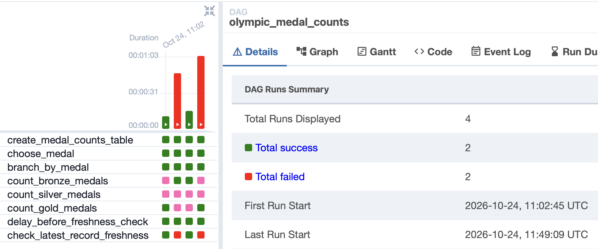
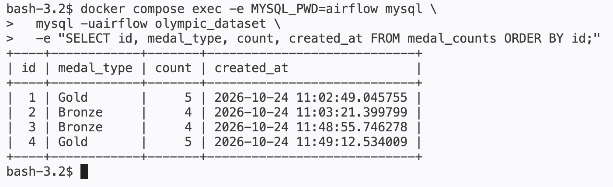

# GOIT DE HW 07 — Apache Airflow та MySQL

Повністю контейнеризоване виконання домашнього завдання з Apache Airflow.
Один `docker compose up` запускає Airflow, окрему MySQL базу з початковим
`olympic_dataset` та PostgreSQL для службових метаданих Airflow.

## Архітектура

```text
                                  ┌─> count_bronze_medals ─┐
create_medal_counts_table         │                        │
          │                       ├─> count_silver_medals ─┼─> delay ─> freshness sensor
          v                       │                        │
   choose_medal ─> branch_by_medal└─> count_gold_medals ───┘
                              │
                              v
              MySQL: olympic_dataset.medal_counts
```

Airflow використовує `LocalExecutor`. PostgreSQL зберігає лише метадані
Airflow, а всі операції домашнього завдання виконуються в MySQL 8.4.

## Структура

```text
.
├── dags/
│   └── olympic_medal_counts.py
├── mysql/init/
│   └── 01_olympic_dataset.sql
├── screenshots/
├── compose.yaml
├── Dockerfile
├── requirements.txt
└── README.md
```

## Початкові дані

Під час першого створення MySQL volume скрипт `mysql/init/01_olympic_dataset.sql`
автоматично створює `athlete_event_results` і додає демонстраційні записи:

| medal | Кількість |
|---|---:|
| Bronze | 4 |
| Silver | 3 |
| Gold | 5 |

## Запуск

У каталозі проєкту виконайте:

```bash
docker compose up --build -d
docker compose ps
```

Перший build може тривати кілька хвилин. Compose очікує готовності баз даних,
виконує міграції Airflow, створює адміністратора, а потім запускає webserver і
scheduler.

Airflow UI: <http://localhost:8080>

- login: `airflow`
- password: `airflow`

## Успішний сценарій: затримка 5 секунд

У UI відкрийте DAG `olympic_medal_counts`, натисніть **Trigger DAG w/ config**,
залиште `delay_seconds = 5` і запустіть його. Або скористайтеся CLI:

```bash
docker compose exec airflow-scheduler \
  airflow dags trigger olympic_medal_counts \
  --conf '{"delay_seconds": 5}'
```

## Негативний сценарій: затримка 35 секунд

Запустіть той самий DAG із більшою затримкою:

```bash
docker compose exec airflow-scheduler \
  airflow dags trigger olympic_medal_counts \
  --conf '{"delay_seconds": 35}'
```

## Скриншоти

Збережені у `screenshots/`:

1. Загальна статистика запусків:   
   Пара успішних запусків з `delay_seconds = 5` та `delay_seconds = 10`.  
   Пара неуспішних запусків з `delay_seconds = 35` та `delay_seconds = 50`.
2. Таблиця `olympic_dataset.medal_counts` із 4 записами: .

## Завершення роботи

Зупинити контейнери зі збереженням баз:

```bash
docker compose down
```

Повністю видалити дані та повторити демонстрацію з чистого стану:

```bash
docker compose down -v
docker compose up --build -d
```
